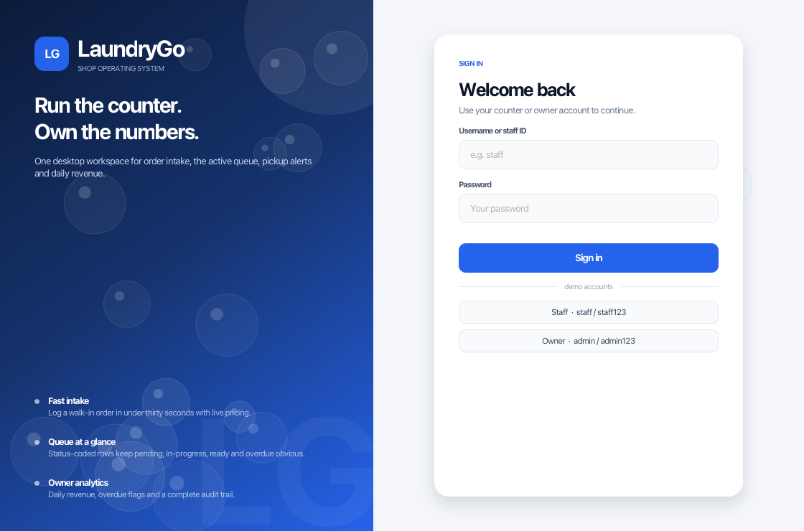
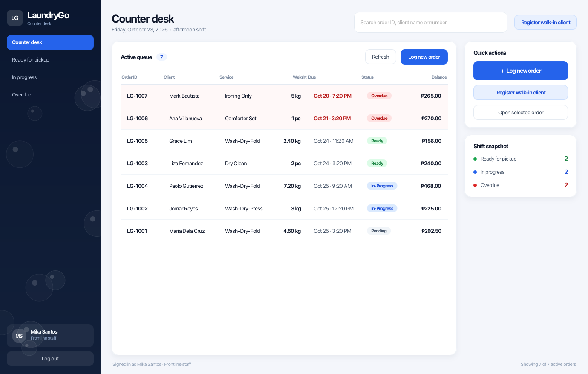
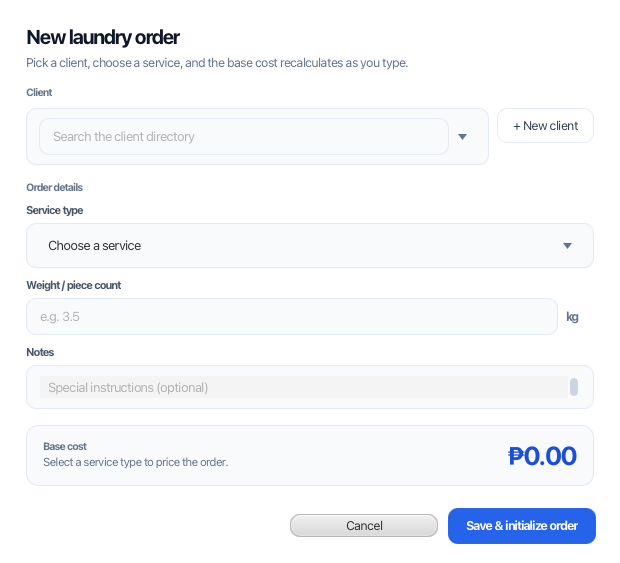
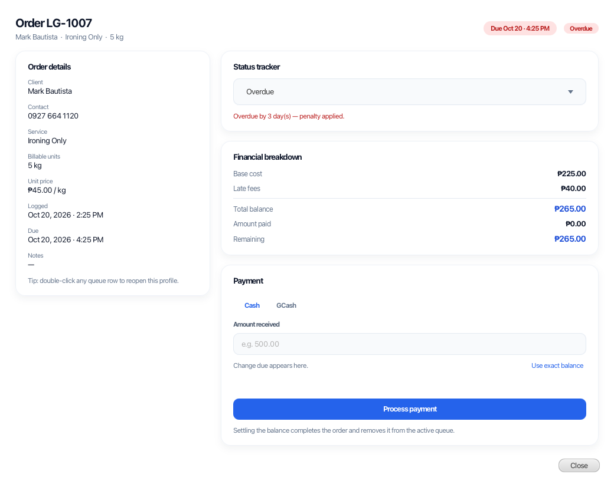
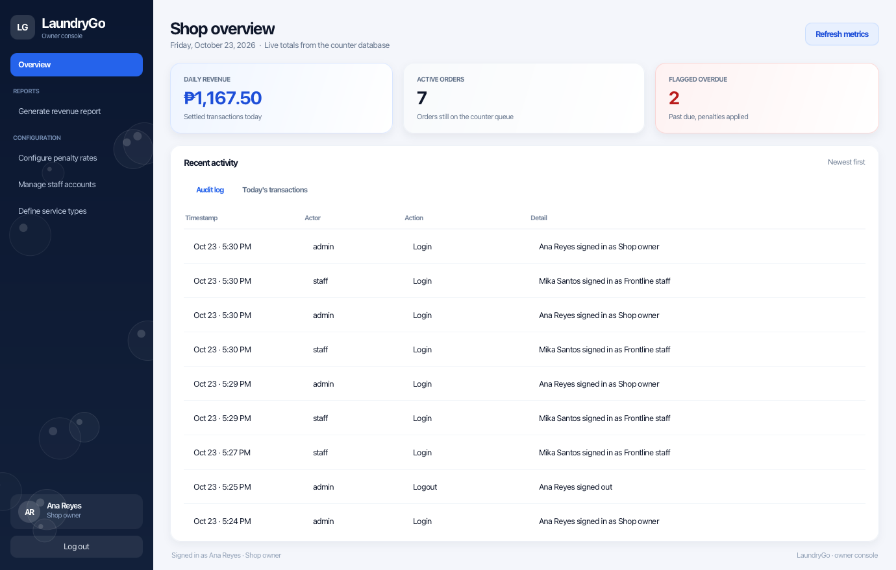
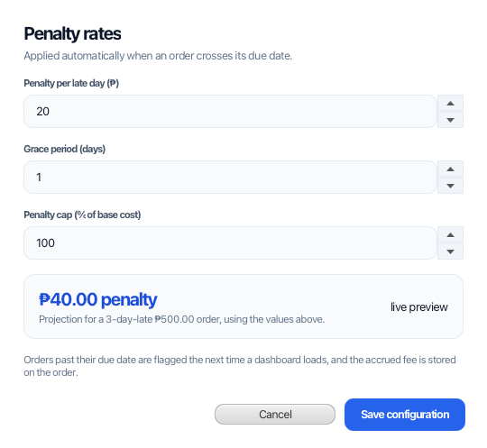
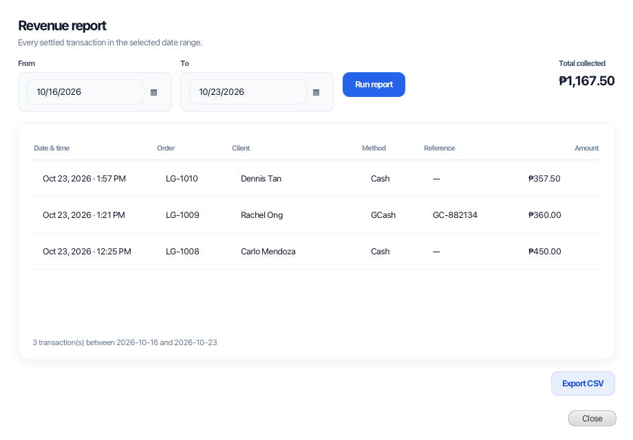
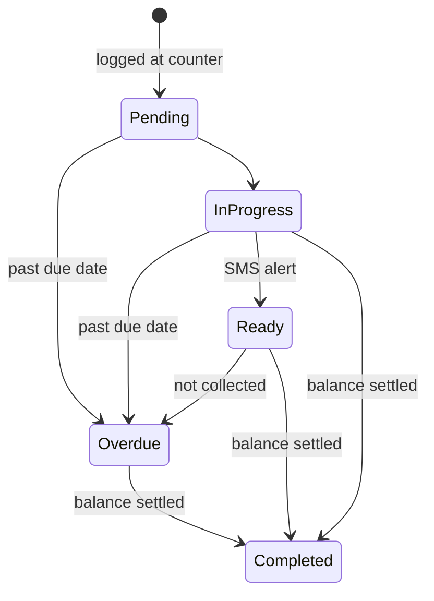

# LaundryGo — Desktop POS & Shop Management

A JavaFX desktop client for a laundry shop: a fast counter workflow for frontline staff and an
analytics / configuration console for the owner. Built as a single Maven application with a
hand-written CSS design system, SQLite persistence and no external services required to run.



---

## Stack decision

The brief allowed **JavaFX with FXML/CSS** or **Swing with FlatLaf**. This implementation uses
**JavaFX 21 + CSS**, because:

* the design system (rounded surfaces, drop shadows, colour-coded status pills) is expressed in one
  stylesheet instead of hundreds of lines of `UIManager` tweaks;
* `TableView` cell factories make the colour-coded status column trivial;
* `Task` + `Platform.runLater` gives clean background work for credential checks and SMS calls;
* it ships with the app through Maven, so there is no extra runtime install.

Everything in the brief maps to JavaFX equivalents: `CardLayout` → scene swapping via
`AppNavigator`, `JDialog` modality → `Dialog` with `Modality.APPLICATION_MODAL`, `JTabbedPane` →
`TabPane`, `JSpinner` → `Spinner`.

## Requirements

* JDK **17+**
* Maven **3.9+**
* macOS, Windows or Linux with a desktop session

## Run

```bash
mvn clean javafx:run
```

Equivalent alternatives (the app is launched through a plain `main`, so every route works):

```bash
# Maven exec plugin, own JVM
mvn exec:exec -Dexec.executable=java -Dexec.args="-classpath %classpath com.laundrygo.LaundryGoApp"

# plain classpath (macOS/Linux separator ':', use ';' on Windows)
mvn -q dependency:build-classpath -Dmdep.outputFile=target/classpath.txt
java -cp "target/classes:$(cat target/classpath.txt)" com.laundrygo.LaundryGoApp
```

The first launch creates `laundrygo.db` in the project root, builds the schema and seeds a demo
shop (service catalogue, clients, a live queue, settled payments and audit history).

### Demo accounts

| Role           | Username | Password   |
| -------------- | -------- | ---------- |
| Frontline staff| `staff`  | `staff123` |
| Shop owner     | `admin`  | `admin123` |

Both accounts also appear as one-click chips on the login screen.

---

## The five frames

### 1. Global login portal


* Branded split layout with the form card centred on the right.
* Login disables the form, shows a spinner and verifies credentials on a background `Task`, so the
  window never freezes.
* Routing is role based: `Role.ADMIN` → owner dashboard, `Role.STAFF` → counter desk.
* Wrong credentials produce an inline error, a shake animation, cleared password and refocused field.

### 2. Staff counter dashboard



* `BorderPane` shell: navigation rail on the left, search in the header, active queue in the centre,
  quick actions and a shift snapshot on the right, status line at the bottom.
* The queue is a `TableView` over a `FilteredList`/`SortedList`, re-queried from SQLite on refresh.
* Typing in the search box filters live on order ID, client name, phone number or service.
* Status is a custom cell (grey pending, blue in-progress, green ready, red overdue) and overdue
  rows get a soft red wash plus a bold red due date.
* Double-clicking a row opens the order profile; the sidebar filters the queue by state.
* **Client directory** (sidebar → Clients, or the quick panel) searches by name or mobile number and
  shows the selected client's profile — contact details, client since, orders logged, open orders and
  lifetime paid — plus their full order history. From there the counter can edit the profile, delete
  it (soft delete: settled orders stay in reporting) or start a new order for that client.
* Sidebar nav: Counter desk · Ready for pickup · In progress · Overdue · Client directory, plus log out.

### 3. Log new order (modal)



* Auto-completing client lookup (key-filtered popup) and an inline “+ New client” form.
* Weight/piece field accepts digits only, with the unit switching between `kg` and `pc` based on the
  chosen service.
* Base cost recalculates on every keystroke and service change, with the formula spelled out
  underneath (`₱65.00 per kg × 3.5 kg`).
* Save writes the order, computes the due date from the service turnaround, closes the dialog and
  refreshes the queue with a success toast.

### 4. Order profile, status tracker & payment



* Read-only details on the left; status tracker, financial breakdown and payment on the right.
* Moving to **Ready** fires an SMS task on a background thread and reports “SMS alert sent to
  0917 ••• 0134 at 2:12 PM”; the status control is locked while the gateway call is in flight.
* Moving to **Overdue** runs the penalty controller immediately and rewrites the Late Fees label,
  showing the chargeable days and the per-day rate.
* Cash tab shows the change due as you type; GCash tab requires a reference number. Processing
  payment writes the ledger row, completes the order and removes it from the queue.
* Settlement opens the **receipt** (order, client, service, base cost, late fee, total, amount paid,
  change, method, reference, cashier). **Print receipt** sends a fresh copy of the paper node to the
  system print dialog, and settled orders can be reprinted later from the client's order history.

### 5. Owner dashboard



* Three metric tiles: daily revenue, active order volume, and flagged overdue items in red.
* Sidebar opens the modular configuration dialogs: revenue report, penalty rates, staff accounts,
  service types.
* Centre area holds the recent audit log and today’s transactions in tabs.

| Penalty configuration | Revenue report |
| --- | --- |
|  |  |

* Penalty dialog previews the effect of the rate/grace/cap before saving.
* Revenue report filters by date range, totals the range, exports CSV and prints a paginated PDF-ready
  sheet (24 transactions per page) through the system print dialog.
* Staff accounts support create, **edit profile** (full name, role, shift), password reset and
  activation/deactivation, each written to the audit log.

---

## Use case coverage

| Use case | Actor | Status | Where |
| --- | --- | --- | --- |
| Login | Staff / Owner | Covered | `LoginView` → `AuthService` |
| Logout | Staff / Owner | Covered | sidebar log out, audit `LOGOUT` |
| View customer profile | Staff | Covered | `CustomerDirectoryDialog` profile card |
| Register customer profile | Staff | Covered | `CustomerFormDialog` (create) |
| Edit customer profile | Staff | Covered | `CustomerFormDialog` (edit) → `CustomerDao.update` |
| Delete customer profile | Staff | Covered | directory → archive (soft delete, blocked while orders are open) |
| Process payment | Staff | Covered | `OrderProfileDialog` → `OrderService.processPayment` |
| Log order | Staff | Covered | `NewOrderDialog` → `OrderService.createOrder` |
| Update laundry status | Staff | Covered | `OrderProfileDialog` status tracker |
| Search customer profile | Staff | Covered | directory search (name / mobile), live table + history |
| Print receipt | Staff | Covered | `ReceiptDialog` after settlement, reprint from client history |
| Search order | Staff | Partial | queue search covers active orders only; settled orders are found via the client's history |
| View daily metrics | Owner | Covered | `AdminDashboardView` stat cards + tabs |
| Generate revenue report | Owner | Covered | `RevenueReportDialog` (date range) |
| Configure penalty rates | Owner | Covered | `PenaltySettingsDialog` → `PenaltyService` |
| Define service type | Owner | Covered | `ServiceTypesDialog` create / update / retire |
| Create staff account | Owner | Covered | `StaffAccountsDialog` → `UserDao.create` |
| View staff account | Owner | Covered | accounts table (name, username, role, shift, status) |
| Edit staff account | Owner | Covered | "Save changes" → `UserDao.updateProfile` (name, role, shift) |
| Deactivate staff account | Owner | Covered | "Activate / deactivate" → `UserDao.setActive` |
| Reset user account | Owner | Partial | password reset is implemented; there is no lockout counter to unlock |
| View audit logs | Owner | Covered | audit tab → `AuditDao.recent` |
| Print report | Owner | Covered | "Print report" in the revenue dialog (`PrintSupport`, paginated) |
| Download report | Owner | Partial | CSV export implemented; no PDF writer |
| Trigger SMS alert | System | Partial | fired on the Ready transition; `SmsService` is a simulated gateway stub |
| Apply late fee | System | Covered | `OrderDao.flagOverdue` on dashboard load + manual Overdue transition |

---

## Business rules

**Base cost** = `service price × billable units` (kilograms for per-kg work, pieces for flat rates).

**Due date** = `logged at + service turnaround days`.

**Penalty** (evaluated whenever a dashboard loads, or when staff explicitly flag an order):

```
chargeable days = max(0, calendar days past due − grace days)
late fee        = min(chargeable days × daily rate, cap % × base cost)
```

Defaults: ₱20 per day, 1 day grace, 100 % cap — all editable by the owner.

**Order lifecycle**



Settling the balance is the only path to `Completed`, so revenue always has a payment row behind it.

---

## Project structure

```
src/main/java/com/laundrygo/
├── LaundryGoApp.java          # main() — deliberately not an Application subclass
├── DesktopApp.java            # JavaFX Application: boot + login scene
├── SmokeTest.java             # headless business-logic checks
├── UiSnapshot.java            # dev helper: renders every frame to PNG
├── model/                     # User, Customer, ServiceType, Order, enums, PenaltyPolicy
├── db/                        # SQLite bootstrap + DAOs (orders, payments, users, audit, settings)
├── service/                   # Auth, Order, Penalty, SMS, Report + AppServices locator
└── ui/
    ├── AppNavigator.java      # single Stage, scene swapping by role
    ├── LoginView.java
    ├── StaffDashboardView.java
    ├── AdminDashboardView.java
    ├── component/             # AppSidebar, StatCard, StatusBadge, Toast
    ├── PrintSupport.java      # lays out + scales printable nodes, drives PrinterJob
    └── dialog/                # NewOrder, OrderProfile, Receipt, CustomerForm,
                              # CustomerDirectory, PenaltySettings, ServiceTypes,
                              # StaffAccounts, RevenueReport
src/main/resources/com/laundrygo/app.css   # design tokens + component styling
```

### Design tokens

| Token | Value | Use |
| --- | --- | --- |
| Primary | `#2563EB` | primary actions, active nav, totals |
| Canvas / surface | `#F4F6FB` / `#FFFFFF` | page and cards |
| Pending | `#64748B` on `#F1F5F9` | queued work |
| In-Progress | `#2563EB` on `#DBEAFE` | in the wash |
| Ready | `#16A34A` on `#DCFCE7` | for pickup |
| Overdue | `#DC2626` on `#FEE2E2` | penalty state |

Typography uses Inter when installed, otherwise the platform UI font (SF Pro, Segoe UI, Roboto).
Cards use 16–20 px radii and soft shadows; dialogs are modal with 20 px content padding.

Soap bubbles (`ui/component/BubbleField.java`) give the brand surfaces their laundry identity: a
seeded field of translucent circles with a highlight, layered behind the login hero, the login form
panel and the navigation rail. The field is mouse-transparent, clipped to its pane and re-flows on
resize, so it never interferes with controls.

---

## Data

* SQLite file `laundrygo.db` in the working directory (override with `-Dlaundrygo.db=/path/file.db`).
* Passwords are stored as salted PBKDF2-HMAC-SHA256 hashes — never plain text.
* Deleting the file resets the app to a freshly seeded demo shop on the next launch.

## Integrating a real SMS gateway

`service/SmsService.java` simulates the provider round-trip so the UI can show its “sending” state.
Replace the body of `ReadySmsTask.call()` with an HTTP call; the task already runs off the FX thread.
On success the profile dialog writes an `SMS_SENT` audit entry.

## Developer utilities

```bash
# 24 assertions over schema, auth, pricing, penalties and settlement (uses a scratch DB)
mvn -q compile exec:java -Dexec.mainClass=com.laundrygo.SmokeTest -Dlaundrygo.db=/tmp/lg.db

# Re-render every frame to /tmp/lg-*.png for design review
mvn -q compile exec:java -Dexec.mainClass=com.laundrygo.UiSnapshot
```

## Notes

* Running Maven on a JDK newer than 21 prints `--enable-native-access` warnings from JavaFX and
  sqlite-jdbc. They are informational; the app still runs on JDK 17+.
* The window minimum is 1024 × 700; the dashboards are laid out for 1280–1440 px counter monitors.

## Troubleshooting

**`Failed to execute goal …exec-maven-plugin:…:exec … Process exited with an error: 1`**

That is the JDK launcher rejecting JavaFX when it is only on the classpath. A class whose `main`
extends `javafx.application.Application` cannot be started with `java -cp …`; the launcher prints
`JavaFX runtime components are missing, and are required to run this application` and returns 1.

`LaundryGoApp` therefore only delegates to `DesktopApp` (the `Application` subclass). Both routes are
valid now, but the classpath must contain the dependencies — pointing `-cp` at `target/classes`
alone gives `NoClassDefFoundError: javafx/application/Application`. Use `%classpath` with the exec
plugin, or generate the classpath file as shown above. If the error persists, run with `-e` and check
the first line of the subprocess output; that names the real cause (wrong main class, missing
classpath, or an exception in `start()`).
